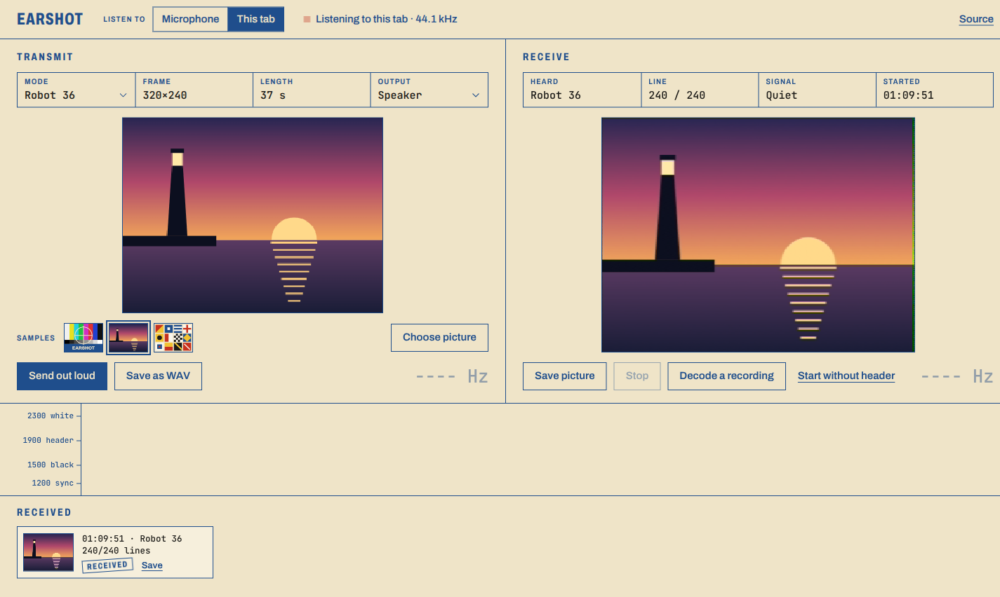

# Earshot

**Send pictures through sound, live.** One device plays a picture out loud. Another device listening nearby draws it line by line from its microphone while the sound is still playing. The encoder and the real-time decoder run in the same browser tab, with no server and no recording step.

**Live app:** https://6sLOGAN78.github.io/earshot/



## Try it

- **Two devices:** open the app on both (e.g. a laptop and a phone). On the receiver, press **Start listening** and allow the microphone. On the sender, pick a picture and press **Send out loud**. Hold them near each other.
- **One device:** set **Listen to** to **This tab**. The transmitter feeds straight into the receiver, and you still hear the signal.
- **Interop:** the signal is standard SSTV, so ham-radio apps such as Robot36 (Android) or QSSTV can decode Earshot's transmissions, and Earshot can decode theirs.

## How it works

Earshot uses **slow-scan television (SSTV)**, the analog method ham radio operators (and the ISS) use to send pictures over voice channels.

1. **Encoding.** Each pixel's brightness becomes a tone between **1500 Hz (black)** and **2300 Hz (white)**. Each line starts with a **1200 Hz sync pulse**. A **VIS header** (1900 Hz leader + 8 bits at 1100/1300 Hz) announces the mode. The waveform is generated phase-continuously at the sound card's sample rate.
2. **Demodulation.** Microphone audio comes off the audio thread through an `AudioWorklet` and goes to a Web Worker. There it is mixed down around 1900 Hz, low-pass filtered (windowed-sinc FIR), and converted to an instantaneous frequency from the phase step between samples.
3. **Decoding live.** The worker watches for the VIS header and picks the mode automatically. It then finds every line's sync pulse and fits a straight line through the pulse positions. That corrects slant when two sound cards' clocks drift apart. Each finished line is posted back to the page and drawn immediately.

| Mode | Picture | Time |
|---|---|---|
| Robot 36 (YCbCr) | 320×240 | 36 s |
| Martin M2 | 320×256 | 58 s |
| Scottie S2 | 320×256 | 71 s |
| Martin M1 | 320×256 | 114 s |
| Scottie S1 | 320×256 | 110 s |

It's analog, so noise shows up as noise in the picture: grain rather than a broken file. Slower modes spend more time per pixel and come through cleaner in a loud room.

### Also

- Drop, paste, or choose any image. It's cover-cropped to the mode's frame.
- **Save as WAV** to send a picture as an audio file.
- **Decode a recording** to read an SSTV audio file.
- **Start without header** to catch a transmission whose header you missed.
- Every received picture is filed in the log, stamped RECEIVED, PARTIAL or VOID, and can be saved as PNG.

## Tips for the room

- Turn the sender's volume up and keep the devices within a metre or two.
- Microphone access needs HTTPS or `localhost`. The hosted version is HTTPS.
- Earshot turns off the browser's echo cancellation, noise suppression and auto-gain, because they would flatten the tones.

## Develop

```bash
npm install
npm run dev      # http://localhost:5173
npm test         # encodes every mode, adds noise and clock drift, decodes, checks the picture
npm run build
```

Stack: Vite + TypeScript, Web Audio (`AudioWorklet`), a Web Worker for DSP, no UI framework. The sample pictures are drawn in code.

## License

MIT
